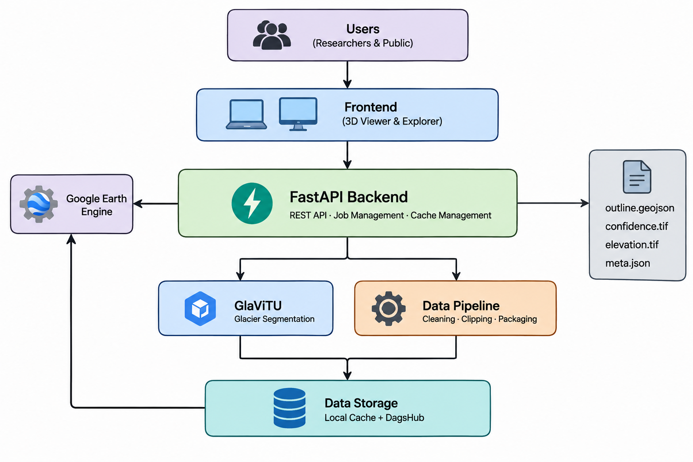

# Open 3D Glacier Change Tracker





An automated, configuration-driven pipeline for generating, storing, inspecting, and comparing glacier outlines across historical satellite imagery in Alaska. The project combines Google Earth Engine imagery retrieval, GlaViTU inference, geospatial post-processing, reusable result packages, and an API for requesting and monitoring processing jobs.

**Contributor:** [@saeed-taj](https://github.com/saeed-taj)  
**Initial configured glacier targets:** Gulkana, Wolverine, and Mendenhall  
**Reference inventory:** Randolph Glacier Inventory (RGI) v7  
**Historical period under investigation:** 2003–2026

> **Status note:** The backend workflow is implemented and configured for Gulkana, Wolverine, and Mendenhall. This does not mean that every year from 2003–2026 has already been processed, reviewed, or scientifically validated for all three glaciers. The historical time series and its consistency still require systematic evaluation.

---

## 1. Project motivation

Alaska contains thousands of glaciers, so a workflow that depends on manually running notebook cells for every glacier and year will not scale well. The project is intended to make glacier-change exploration more repeatable by automating the processing steps and allowing a user to request a particular glacier and year.

The project has two intended audiences:

- **General users:** Explore glacier outlines and terrain across years, inspect how the mapped extent changes, and compare selected years through a future web interface.
- **Researchers:** Inspect the geospatial outputs, source imagery, model provenance, processing parameters, reference-outline comparisons, quality indicators, and other metadata needed to evaluate and reuse the results.

The initial implementation focuses on three configured Alaska glacier targets—Gulkana, Wolverine, and Mendenhall. The longer-term proposal is to extend the same configuration-driven workflow to additional glaciers rather than creating a separate processing implementation for every target.

## 2. Current glacier targets and configuration

The application currently has three glacier targets configured in `config/glaciers.yaml`:

- **Gulkana Glacier**
- **Wolverine Glacier**
- **Mendenhall Glacier**

All three are included in the configuration and are supported targets in the current application workflow. The configuration-driven design keeps glacier-specific settings separate from the shared processing logic.

This is important for extending the project. Adding another glacier should primarily require adding its configuration and checking that the required reference geometry, imagery coverage, projection, and processing assumptions are suitable. Each newly added target still needs to be tested and its outputs reviewed; configuration alone is not scientific validation.

## 3. Processing pipeline

The backend exposes an on-demand workflow for a requested glacier/year. Instead of manually launching each processing stage, a client can submit a request to the API. The backend checks whether the result or its inputs already exist and only performs the missing work.

### 3.1 Pipeline stages

1. **Check the local result cache.**  
   The backend first checks whether a completed glacier/year package is already available locally. If it is, the existing package can be reused.

2. **Check remote DagsHub storage.**  
   If the package is not available locally, the backend checks the remote DagsHub S3-compatible storage. An existing remote package can be retrieved instead of running inference again.

3. **Check the imagery cache.**  
   Before fetching new imagery, the workflow checks whether the required Landsat rasters have already been downloaded. Existing rasters are reused where possible, avoiding unnecessary Earth Engine requests.

4. **Fetch imagery from Google Earth Engine when required.**  
   If the required imagery is missing, the pipeline fetches the Landsat data through Google Earth Engine using the configured acquisition and preprocessing settings.

5. **Run GlaViTU inference.**  
   The imagery is passed to the GlaViTU inference workflow to generate a glacier prediction.

6. **Clean small polygons.**  
   The prediction is post-processed to remove small polygon components according to the configured minimum-area rule.

7. **Clip the prediction to the reference region.**  
   The output is clipped using the corresponding RGI v7 glacier outline and configured buffer. The buffer is a processing parameter and can affect the resulting area and comparison statistics.

8. **Create the yearly output package.**  
   The resulting glacier outline, confidence raster, elevation raster, and metadata are written as a standardized package.

9. **Upload the package to remote storage.**  
   The package is uploaded to the DagsHub S3-compatible bucket in the background. The `meta.json` file is uploaded last so that the presence of metadata can be used as a completion indicator rather than treating a partially uploaded package as ready.

### 3.2 Cache-aware processing

The cache checks are intended to reduce repeated downloads and inference runs:

- A locally available completed package is reused.
- A remotely available completed package is retrieved.
- Previously fetched imagery is reused when possible.
- Earth Engine is used when the required imagery is not already available.

This makes the workflow useful both for first-time processing and for repeated requests for results that have already been generated.

### 3.3 Background jobs and duplicate-request handling

Processing can take longer than a normal API request should remain open. The process endpoint therefore creates or reuses a background job and returns a job identifier. The client can poll the job endpoint to check the current state.

The job-handling logic is designed to be idempotent for a glacier/year:

- If the requested year is already ready, the API returns the existing ready result rather than starting another inference run.
- If a job for the same glacier/year is already running, the API returns that existing job.
- If neither condition applies, the backend creates a new job.

Requests for the same glacier/year share one job. Inference is currently serialized so that only one inference job runs at a time. This avoids duplicate processing for repeated requests, although it also means concurrent inference throughput is currently limited.

## 4. REST API

The backend currently exposes the following endpoints.

| Method | Endpoint | Purpose |
|---|---|---|
| `GET` | `/api/health` | Check API health. |
| `GET` | `/api/glaciers` | List the glacier targets configured in the application. |
| `GET` | `/api/glaciers/{glacier}/years` | List years and their availability/status for a glacier. |
| `GET` | `/api/glaciers/{glacier}/years/{year}` | Retrieve the processed data/package for a glacier and year. |
| `POST` | `/api/glaciers/{glacier}/years/{year}/process` | Request processing, reusing an existing result or job when possible. |
| `GET` | `/api/jobs/{job_id}` | Retrieve a job's status and current processing step. |

### 4.1 Example: request a year

Example request for Gulkana in 2016:

```bash
curl -X POST \
  'http://127.0.0.1:8000/api/glaciers/gulkana/years/2016/process' \
  -H 'accept: */*' \
  -d ''
```

The API returned HTTP `202 Accepted` with a job identifier:

```json
{
  "glacier": "gulkana",
  "year": 2016,
  "status": "running",
  "step": "checking_cache",
  "source": null,
  "error": null,
  "job_id": "5e8a3f376a83",
  "created": true
}
```

The request returns without waiting for the entire imagery and inference workflow to finish. The processing continues as a background job.

### 4.2 Monitor job progress

The client can use the returned job ID:

```bash
curl -X GET \
  'http://127.0.0.1:8000/api/jobs/5e8a3f376a83' \
  -H 'accept: */*'
```

During the test, the job progressed from `checking_cache` to `inferring`. The same endpoint can be called again to retrieve the latest job state.

After processing, the job returned:

```json
{
  "glacier": "gulkana",
  "year": 2016,
  "status": "ready",
  "step": "ready",
  "source": "computed",
  "error": null,
  "job_id": "5e8a3f376a83"
}
```

This confirms that the requested year passed through the on-demand workflow and reached the ready state. The `source: computed` value indicates that the result was generated by processing rather than simply returned from an existing completed package.

### 4.3 Observed job duration

In this test, the recorded job start and finish timestamps were approximately 170 seconds apart (about 2 minutes 50 seconds). This is the total observed job duration. It should not be interpreted as the GlaViTU inference time alone because the job includes other pipeline stages.

The workflow has also been tried in a free Google Colab T4 environment. A reliable stage-by-stage timing comparison between the Colab T4 and the local NVIDIA MX250 (2 GB) has not yet been completed.

## 5. Output package

Every processed glacier/year is organized into a consistent package:

```text
outline.geojson
confidence.tif
elevation.tif
meta.json
```

### 5.1 `outline.geojson`

Contains the predicted glacier boundary as geospatial vector features. The features include polygon-level properties such as area.

The GeoJSON can be opened in GIS software and can also be used by the planned frontend to display glacier boundaries on a map or as part of a 3D terrain experience.

### 5.2 `confidence.tif`

Contains the model's spatial confidence output. It allows users to inspect how confidence varies across the prediction rather than relying only on the final binary/vector outline.

### 5.3 `elevation.tif`

Contains elevation information associated with the output area. It can be used with the glacier geometry for terrain visualization and elevation-based analysis.

### 5.4 `meta.json`

Contains structured metadata describing the glacier, reference inventory, prediction, imagery, model, post-processing, spatial grid, software environment, processing run, output files, and quality information.

The metadata is intended to make results traceable and interpretable. It is not just a record of the predicted area: it also preserves information needed to understand how the result was produced and what limitations should be considered.

## 6. Metadata schema and research traceability

The metadata records information in the following groups. The exact values vary by glacier and year.

| Group | Information recorded |
|---|---|
| Schema | Metadata schema version. |
| Glacier identity | Glacier name and RGI identifier. |
| Year | Target imagery/output year. |
| Prediction results | Predicted area, reference RGI area, area difference in km² and percentage, polygon count, perimeter, and pixel-count area. |
| RGI comparison | Overlap area, predicted area outside the reference outline, reference area not predicted, reference polygon area, IoU, Dice, and clipping-buffer distance. |
| Elevation statistics | Minimum, median, mean, and maximum elevation. |
| Hypsometry | Glacier area distributed across 100 m elevation bands. |
| Confidence | Mean confidence, configured low-confidence threshold, and fraction of the output below that threshold. |
| RGI attributes | RGI ID, region codes, GLIMS ID, analysis/submission identifiers, reference source date, centroid coordinates, UTM zone, area, glacier class, glacier name, terminus coordinates, elevation attributes, slope, aspect, DEM source, length, and matched polygon information where available. |
| Imagery provenance | Landsat sensor, seasonal acquisition window, maximum cloud threshold, number of scenes, DEM source, scene identifiers, per-scene cloud cover, valid-pixel fraction, optical percentile values, imagery status, and warnings. |
| Model provenance | GlaViTU model/weights information, weights filename, SHA-256 hash, GlaViTU commit, patch size, median smoothing setting, and input pixel size. |
| Post-processing | Minimum polygon area, polygon counts and areas before/after cleaning, and clipping-buffer setting. |
| Spatial grid | CRS, pixel size, raster dimensions, and spatial bounds. |
| Software environment | Python, GeoPandas, rasterio, and GDAL versions. |
| Processing run | Processing timestamp, runtime, and application/pipeline commit. |
| Output files | Names of the generated GeoJSON, confidence raster, elevation raster, and metadata file. |
| Quality | Quality flags and warnings intended to help users identify results that need further inspection. |

### 6.1 Example: Wolverine Glacier, 2005

One generated Wolverine 2005 metadata record provides a concrete example of the information preserved by the package.

**Area and RGI comparison**

| Metric | Recorded value |
|---|---:|
| Predicted area | 17.2499 km² |
| RGI reference area | 16.5436 km² |
| Area difference | +0.7063 km² |
| Area difference | +4.27% |
| Overlap area | 16.2973 km² |
| Predicted area outside RGI | 0.9526 km² |
| RGI area not predicted | 0.2375 km² |
| RGI polygon area used in comparison | 16.5348 km² |
| IoU | 0.9319 |
| Dice | 0.9648 |
| Clipping buffer | 100 m |

The record also reports a pixel-count area of approximately 17.2502 km², three output polygons, and a perimeter of approximately 29.299 km.

**Elevation and confidence**

| Metric | Recorded value |
|---|---:|
| Minimum elevation | 425 m |
| Median elevation | 1,278 m |
| Mean elevation | 1,222.4 m |
| Maximum elevation | 1,666 m |
| Mean confidence | 0.182 |
| Low-confidence threshold | 0.5 |
| Low-confidence fraction | 1.0 |

**Imagery provenance**

- Sensor: Landsat 5 (`LT05`).
- Seasonal window: 20 July to 20 September.
- Maximum configured cloud cover: 30%.
- Number of scenes: 2.
- DEM source: AW3D30.
- Scene IDs: `LT05_068018_20050808` and `LT05_067018_20050918`.
- Recorded scene cloud cover: 18% and 28%.
- Valid-pixel fraction: 1.0.
- Imagery status: `ok`.

**Model and processing provenance**

- Model weights: GlaViTU global weights.
- Weights file: `glavitu_global_weights.h5`.
- SHA-256: `b5e14245491a62995497aecb3d3628e6e8ca4efe93e85126467e78d1de48b564`.
- GlaViTU commit: `8c4eead`.
- Patch size: 384 pixels.
- Median smoothing: 3.
- Input pixel size: 10 m.
- Minimum polygon area: 5,000 m².
- Tile polygon count: 17 before cleaning and 14 after cleaning.
- Tile area: 80.0173 km² before and 80.0113 km² after cleaning.
- Spatial CRS: `EPSG:32606`.
- Pixel size: 10 m.
- Raster shape: 711 × 532.
- Recorded environment: Python 3.10.22, GeoPandas 1.1.4, rasterio 1.4.4, GDAL 3.10.3.
- Processing timestamp: `2026-11-20 15:36:51 UTC`.
- Recorded runtime: 141.6 seconds.
- Pipeline commit: `040a084`.

### 6.2 Interpreting the metrics carefully

The Wolverine 2005 example reports a high IoU and Dice score against the selected RGI outline, but its mean confidence is 0.182 and the low-confidence fraction is 1.0 under the configured threshold of 0.5. This is a quality signal that needs investigation.

IoU and Dice measure spatial agreement with the selected reference outline. They do not prove that the model is correct, and the RGI outline should not automatically be treated as exact ground truth for the Landsat acquisition year. Differences can arise from reference dates, seasonal snow, sensor characteristics, mapping conventions, outline delineation, and the configured clipping buffer.

Keeping comparison metrics, confidence information, imagery provenance, and warnings together is intended to make these issues visible to researchers rather than presenting one score or area value without context.

## 7. Preliminary Gulkana observations

An early comparison for Gulkana in 2013 produced an estimated model area of approximately 19.3 km², compared with approximately 17.6 km² for the RGI v7 reference.

The spatial comparison was approximately:

- Overlap: 16.18 km².
- Predicted outside the RGI outline: 3.13 km².
- RGI area not predicted: 1.37 km².
- IoU: approximately 0.78.

In the years checked so far (2003, 2006, and 2013), the predicted area was roughly 10–18% above the RGI reference area.

These observations are preliminary sanity checks, not evidence of glacier growth or a validated temporal trend. The imagery years do not necessarily match the reference-outline date. Potential sources of discrepancy include seasonal snow near glacier margins, differences in outline delineation, the 100 m clipping buffer, and Landsat sensor transitions. A systematic year-to-year review is required before drawing conclusions about glacier change.

## 8. Repository structure

The application repository is organized to keep API handling, orchestration, configuration, geospatial processing, tests, and project documentation in separate areas.

```text
alaska_glacier_change_tracker/
├── app/
│   └── api/
│       └── main.py
├── config/
│   └── glaciers.yaml
├── data/
│   ├── catalog.json
│   ├── download_summary.csv
│   ├── raw/
│   └── reference/
│       └── rgi7_alaska_targets.gpkg
├── docs/
│   ├── architecture.md
│   ├── data_inventory.md
│   ├── plan.md
│   ├── preprocessing_stats.md
│   ├── problem_scope.md
│   └── research_review.md
├── experiments/
│   └── alaska_glacier_change_inference.ipynb
├── server/
│   ├── app.py
│   ├── catalog.py
│   ├── config.py
│   ├── jobs.py
│   ├── pipeline.py
│   └── storage.py
├── src/
│   ├── change_detection/
│   │   └── run_clean_inference.py
│   ├── clipping/
│   │   ├── clean_tiny_polygon.py
│   │   ├── clipping.py
│   │   └── gulkana_check_again.py
│   ├── gee/
│   │   └── fetch_rasters.py
│   ├── package/
│   │   └── make_package.py
│   ├── postprocessing/
│   │   └── clipping.py
│   └── preprocessing/
└── tests/
    ├── test_api.py
    ├── test_catalog.py
    ├── test_jobs.py
    ├── test_pipeline_e2e.py
    └── test_scripts.py
```

### 8.1 Main repository areas

- **`app/api/`** — API entry point and route definitions.
- **`config/`** — glacier-specific configuration, including the configured glacier targets in `glaciers.yaml`.
- **`data/`** — local catalog, download summary, raw data, and reference inventory data. Large datasets and generated outputs are not represented fully in this abbreviated tree.
- **`docs/`** — project scope, architecture, research review, data inventory, preprocessing statistics, and planning notes.
- **`experiments/`** — inference and experimentation notebook.
- **`server/`** — application orchestration, configuration loading, catalog handling, job management, pipeline coordination, and storage integration.
- **`src/gee/`** — Google Earth Engine imagery retrieval.
- **`src/change_detection/`** — GlaViTU inference execution.
- **`src/clipping/` and `src/postprocessing/`** — prediction cleanup and geospatial clipping/post-processing.
- **`src/package/`** — creation of standardized output packages.
- **`src/preprocessing/`** — imagery preparation and preprocessing utilities.
- **`tests/`** — API, catalog, job, end-to-end pipeline, and script tests.

The GlaViTU codebase is cloned and maintained separately from the application repository. It is used as the inference codebase by this application; it is not shown as a subdirectory in the tree above.

The application currently uses a JSON catalog to track available years. A database has been deferred at this stage.

## 9. Current implementation boundaries

The following distinctions are important when interpreting the current status:

- The automated backend is configured for Gulkana, Wolverine, and Mendenhall.
- The full 2003–2026 time series has not yet been completely generated and reviewed for all three glaciers.
- Preliminary area and RGI comparison values are not validated glacier-change measurements.
- The observed 170-second job duration is an end-to-end job measurement, not a model-only inference benchmark.
- The frontend has not yet been implemented.
- Adding a glacier to configuration does not by itself establish that all its years have sufficient imagery or that its outputs are scientifically validated.

## 10. Planned work

### 10.1 Frontend and visualization

Build the public-facing interface with:

- A map and 3D terrain view.
- Glacier outline visualization.
- A year slider for exploring available years.
- A comparison mode for viewing selected years side by side or overlaid.
- A metadata/provenance panel showing imagery sources, model information, and processing details.
- Data-quality information so users can distinguish available outputs from outputs that need further review.

### 10.2 Historical time-series processing

Process and review the historical years from 2003–2026 for the initial glacier targets. Review year-to-year consistency and identify years with limited imagery, unusual predictions, or potential sensor-related differences.

### 10.3 Scientific and geospatial validation

- Compare predictions against suitable reference outlines.
- Investigate the effect of the clipping-buffer distance.
- Examine the impact of seasonal snow and acquisition dates.
- Review Landsat sensor transitions and years with limited valid imagery.
- Avoid interpreting area differences as real glacier change until the temporal outputs have been checked.

### 10.4 Extend to additional Alaska glaciers

Use the existing configuration-driven workflow to add further glaciers. Candidate selection should consider historical imagery coverage, available reference outlines, research value, and the ability to evaluate the results. Each new glacier should be tested before being treated as a validated target.

### 10.5 Performance evaluation

Benchmark individual pipeline stages rather than reporting only one total duration. Compare local hardware with Colab T4 where possible, and identify whether imagery retrieval, preprocessing, inference, post-processing, or storage is the main bottleneck.

## 11. Questions for maintainers and the research community

1. **Reference outlines:** Is RGI v7 suitable as an initial reference for sanity checks, or would you recommend dated glacier outlines for temporal comparison?
2. **Glacier prioritization:** Which additional Alaska glaciers should be prioritized after Gulkana, Wolverine, and Mendenhall, especially those with historical outlines or validation datasets?
3. **Seasonal snow and delineation:** Are there datasets, methods, or mapping conventions you recommend for distinguishing actual glacier change from seasonal snow and differences in outline delineation?
4. **Validation practice:** What validation strategy would you recommend when the available reference outline and satellite acquisition do not represent exactly the same date?

## 12. Summary

The main implementation milestone is that the workflow is no longer dependent on manually running each processing stage for every glacier/year. A client can request a glacier/year through the API, the backend checks local and remote caches, fetches missing imagery when necessary, runs GlaViTU, post-processes the prediction, creates a standardized output package, and exposes job progress through a job ID.

The current configured targets are **Gulkana, Wolverine, and Mendenhall**. The project is designed to extend this workflow to additional Alaska glaciers through configuration. Its output packages include geospatial data and detailed metadata so that the results can support both public visualization and research inspection.

The next major steps are to complete the frontend, generate and review the historical time series, strengthen validation and quality assessment, benchmark the processing stages, and expand the set of configured glaciers.

---